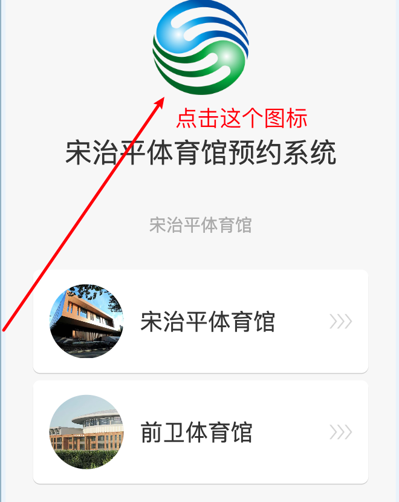

# 吉林大学体育馆前端页面

**当你去体育馆发现没有空余的场地，而这个时候你也没有提前预约，此时不要沮丧，其实大多数同学也没有预约就来打球了，这个时候你可以来使用一个假的预约信息来骗一下同学，就跟他们说这个场地是你预约的，其实很多时间都能成功，但是也要注意他的风险，而这个项目就为你提供了一个假的页面，如果感觉有用的话就点一个✨🌟吧**


## 🌐 在线访问

[https://gym.meiyh9924.xyz/](https://gym.meiyh9924.xyz/)


## 页面说明

进入场馆选择页后，点击顶部 Logo 可以打开隐藏的“预约设置”入口。设置完成之后就能进入页面查看预约的结果了。

<p align="center">
  
</p>

<p align="center">
  <sub>点击顶部 Logo 打开预约设置</sub>
</p>

保存预约后，可从“我的”进入“我的预约”，查看所有预约卡片。预约信息存储在本地浏览器中不会消失。

## 快速部署

先安装 [Node.js](https://nodejs.org/)和 [Git](https://git-scm.com/downloads)，然后在终端运行：

**macOS / Linux**

```bash
curl -fsSL https://raw.githubusercontent.com/xiaoyoumi9924/jlu-gym-frontend/main/scripts/quick-start.sh | bash
```

**Windows**

```powershell
irm https://raw.githubusercontent.com/xiaoyoumi9924/jlu-gym-frontend/main/scripts/quick-start.ps1 | iex
```
## 从源码运行

先安装 [Node.js](https://nodejs.org/)和 [Git](https://git-scm.com/downloads)，然后在终端运行：

```bash
git clone --depth 1 https://github.com/xiaoyoumi9924/jlu-gym-frontend.git
cd jlu-gym-frontend
npm install
npm run dev
```

开发服务器启动后，打开终端中显示的地址，通常是 <http://localhost:5173/>。
按 `Ctrl+C` 停止服务器；下次运行只需在项目目录执行 `npm run dev`。

## 说明文档

- [页面与操作说明](docs/页面说明.md)：页面功能、可点击区域、完整演示步骤和数据重置方法。
- [技术说明](docs/技术说明.md)：技术栈、目录结构、路由、数据模型、组件和测试说明。
